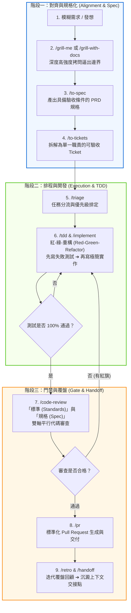

# 🛠️ Matt Pocock Agent Skills 專案使用權威指南 (繁體中文版)

> **核心定位**：本指南為本專案專屬之 Agent 協作規範手冊。導入自 Matt Pocock 官方 GitHub 最新版（共 38 個技能），專注於**消滅無序的盲目編碼 (Vibe Coding)**，建立可重複驗證、嚴密防禦與端到端閉環的高效 AI 配對開發體系。

---

## 🚀 零、 第一次使用必備：專案初始化設定 (First-Time Setup)

> [!IMPORTANT]
> **新專案第 0 步**：在剛安裝好本技能庫後，**切勿直接開始寫代碼或拆解票券**！您必須先在對話中執行初始化指令：
> ```bash
> /setup-matt-pocock-skills
> ```

### 為什麼第一次必須執行 `/setup-matt-pocock-skills`？
後續的所有工程技能（如 `/to-tickets`、`/triage`、`/to-spec`、`/domain-modeling`）都仰賴專案級別的「環境約定」。若未執行初始化，Agent 將不知道 Issue 該寫到哪裡、標籤用什麼名稱、術語該查哪份文檔。

### 初始化會為您配置的 3 大基石：
1. **Issue 追蹤器 (Issue Tracker)**：
   * **GitHub Issues**（預設，透過官方 `gh` CLI 自動開票與維護標籤）。
   * **本地 Markdown**（將任務票券存在專案 `.scratch/<feature>/` 中，適合個人專案或無遠端 repo）。
2. **Triage 5 大標籤規範 (Label Vocabulary)**：
   * `needs-triage`（待分流審核）
   * `needs-info`（需補充資訊）
   * `ready-for-agent`（可直接交由 AI 開發）
   * `ready-for-human`（需人類介入決策）
   * `wontfix`（不予處理/超出範疇）
3. **領域文檔與架構決策 (Domain Docs & ADR)**：
   * 自動建立 `GLOSSARY.md`（通用術語表）與 `docs/adr/`（架構決策紀錄目錄）。
   * 自動在專案根目錄的 `AGENTS.md`（或 `CLAUDE.md`）寫入 `## Agent skills` 規範錨點。

---

## 🔄 一、 核心閉環開發工作流 (The Closed-Loop Workflow)

在軟體工程中，90% 的 Bug 與返工源自於「前期需求模糊」與「未經測試的盲目編碼」。以下為官方推薦的 9 步標準閉環工作流：



### 9 步工作流操作細節：
1. **拷問對齊 (`/grill-me` / `/grill-with-docs`)**：嚴禁一上來就讓 Agent 寫代碼。先針對架構、極端邊界（Edge Cases）與技術選型進行單問單答，把隱性假設全部逼出。
2. **規格落實 (`/to-spec`)**：將剛才對齊的所有共識，固定為具有明確「驗收條件 (Acceptance Criteria)」的產品需求文件 (PRD)。
3. **任務細切 (`/to-tickets`)**：將巨型 PRD 拆解為彼此獨立、可在 30 分鐘內單獨完成與驗證的小型任務票券。
4. **任務分流 (`/triage`)**：指派任務執行順序，標註相依性與風險等級。
5. **測試驅動 (`/tdd`)**：嚴格遵守「紅（寫出失敗測試）➔ 綠（用最簡代碼通過）➔ 重構（消除重複）」三部曲。
6. **精確實現 (`/implement` / `/implement-spec`)**：只寫滿足測試所需的最少代碼，嚴禁自行腦補未經授權的額外功能。
7. **雙軸審查 (`/code-review`)**：代碼寫完後，同時自「團隊架構標準」與「PRD 業務規格」兩條平行線進行審核，非黑即白。
8. **標準交付 (`/pr`)**：產生結構化變更說明與自動化驗收清單，準備合併代碼。
9. **覆盤與交接 (`/retro` / `/handoff`)**：總結本次經驗教訓，將關鍵決策與未竟事項歸檔為交接脈絡，避免長期會話 Token 遺忘。

---

## 💡 二、 實戰場景速查手冊 (Scenario Quick-Lookup)

當您遇到特定情境，不知道該調用哪個指令時，請查閱下表：

| 開發情境 (Scenario) | 推薦調用鏈 (Recommended Pipeline) | 預期交付物 (Artifact) |
| :--- | :--- | :--- |
| **A. 全新功能 / 模組起步** | `/grill-me` ➔ `/to-spec` ➔ `/to-tickets` | 邊界決策樹 ➔ PRD 規格書 ➔ 拆解票券清單 |
| **B. 排除難纏 Bug / 崩潰排查** | `/diagnosing-bugs` ➔ `/wait-what` ➔ `/tdd` | 根本原因分析 (RCA) ➔ 失敗重現測試 ➔ 修復代碼 |
| **C. 代碼凌亂 / 系統架構重構** | `/wayfinder` ➔ `/codebase-design` ➔ `/improve-codebase-architecture` | 依賴拓撲圖 ➔ 架構決策紀錄 (ADR) ➔ 重構步驟 |
| **D. 概念不清楚 / 想理解技術** | `/teach` ➔ `/scaffold-exercises` | 費曼圖解筆記 ➔ 結構化實戰練習題 |
| **E. 長期複雜目標 / 多 Agent 協作** | `/chief-of-staff` ➔ `/handoff` | 專案 Wiki 庫 ➔ 跨會話記憶錨點 |
| **F. 程式碼提交前安全把關** | `/git-guardrails-claude-code` ➔ `/setup-pre-commit` | 本地 Git 攔截鉤子 ➔ 防誤推/防刪除保護 |

---

## 🛡️ 三、 開發者常忽略的 4 大防禦法則 (What You Might Have Missed)

### 1. 縫隙測試法則 (Test Seams vs Implementation Details)
* **盲點**：許多人寫測試時，過度 Mock 類別內部私有方法或底層結構，導致每次重構代碼時，測試全數崩潰報錯。
* **守則**：使用 `/tdd` 時，必須在「公開介面縫隙 (Public Seams)」進行測試。測試的是**輸入與輸出合約行為**，而非內部變數名稱或實作細節。

### 2. 疑點強制熔斷機制 (`/wait-what`)
* **盲點**：Agent 在實作過程中遇到前後矛盾的邏輯時，常常會自行妥協或用 Hack 手法強行湊出結果。
* **守則**：一旦在推演過程中發現「依賴衝突」、「邏輯悖論」或「潛在嚴重效能陷阱」，強制呼叫 `/wait-what`。停下所有敲鍵盤動作，將問題直接拋回給人類進行常識拷問。

### 3. 上下文衰退與 Token 截斷防護 (`/handoff` & Wiki)
* **盲點**：在單一會話中持續交談超過 30~50 輪時，LLM 會發生注意力衰減 (Attention Degrade)，忘記一開始的約定並產生幻覺。
* **守則**：
  * 會話達到長度臨界點前，執行 `/handoff` 產出當前專案狀態摘要（包含：已完成、阻塞點、下三步行動）。
  * 結合 `/chief-of-staff` 將關鍵架構知識隨時寫入專案文件，代碼狀態依賴 Git，架構知識依賴文檔，會話可隨時關閉並重啟。

### 4. Git 破壞性操作物理防火牆 (`/git-guardrails-claude-code`)
* **盲點**：Agent 為了排解衝突或強制同步，可能會不慎提出 `git reset --hard HEAD~5` 或 `git push --force`，造成未提交工作的永久毀滅。
* **守則**：本技能庫預設啟動 Git 護欄，強制攔截高風險指令，任何不可逆變更必須先建立備份分支並由使用者明確輸入授權。

---

## 📂 四、 38 個技能完整對照索引表

| 技能代碼 (Folder) | 技能中文名稱 | 核心功能摘要 |
| :--- | :--- | :--- |
| `ask-matt` | **諮詢 Matt Pocock 思維** | 以 Matt Pocock 的 TypeScript 與 Agent 工作流經驗進行諮詢與解答。 |
| `chief-of-staff` | **幕僚長協調** | 在單一會話中協同調度子代理人 (Subagents)、排程與 Wiki，持續推進長期目標。 |
| `claude-handoff` | **Claude 上下文交接** | 產出符合 Claude 格式的高品質長會話交接脈絡文檔。 |
| `code-review` | **程式碼審查** | 自指定基準點以「標準 (Standards)」與「規格 (Spec)」雙軸平行審查 Diff。 |
| `codebase-design` | **程式碼庫架構設計** | 進行模組化與架構規劃，採用雙重設計構思與深入設計原則。 |
| `diagnosing-bugs` | **錯誤診斷與排錯** | 引導人機協同 (Human-in-the-Loop) 排錯流程，從日誌與再現步驟精準定位問題根源。 |
| `domain-modeling` | **領域模型建構** | 建立通用語言 (Ubiquitous Language) 與架構決策紀錄 (ADR)。 |
| `git-guardrails-claude-code` | **Git 安全護欄** | 防禦高風險 Git 破壞性命令（如強制推送、盲目重置）。 |
| `grill-me` | **方案高強度拷問** | 透過連續深度提問逼出開發細節與邊界防禦。 |
| `grill-with-docs` | **結合文件進行深度審視** | 透過高強度提問審視開發計畫，並同步生成 ADR 與領域詞彙表。 |
| `grilling` | **拷問面試工作流** | 執行高密度單問單答，沿著決策樹鎖定設計決策。 |
| `handoff` | **上下文交接** | 在長任務或長對話中產生精準的上下文交接點紀錄 (Handoff Artifact)。 |
| `implement` | **任務實作** | 將規格或 Issue 轉化為乾淨、安全且具備完整測試的程式碼。 |
| `implement-spec` | **依據規格實作** | 嚴格依據 PRD 需求規格說明書落實代碼與自動化驗收。 |
| `improve-codebase-architecture`| **改善程式碼庫架構** | 分析系統瓶頸，產出架構改善報告與重構藍圖。 |
| `loop-me` | **迴圈反覆微調** | 建立閉環反覆迭代測試與自動修正迴圈。 |
| `migrate-to-shoehorn` | **遷移至 Shoehorn** | 協助套件或架構遷移至 Shoehorn 規範。 |
| `pr` | **PR 審核與提交** | 標準化 Pull Request 生成、變更說明與自動化檢查清單。 |
| `prototype` | **快速原型開發** | 快速構建使用者介面 (UI) 與核心邏輯 (Core Logic) 原型。 |
| `research` | **技術調研** | 針對新技術或套件進行可行性調查與一手文件研究。 |
| `retro` | **迭代覆盤回顧** | 針對剛完成的任務週期或重大變更進行工程覆盤與經驗總結。 |
| `scaffold-exercises` | **腳手架練習生成** | 為教學或技術驗證產生結構化的練習框架。 |
| `setup-matt-pocock-skills` | **初始化技能庫設定** | 設定專案的 Issue 追蹤器 (GitHub/GitLab/Local) 與 Triage 標籤。 |
| `setup-pre-commit` | **設定 Pre-commit 檢查** | 配置自動化 pre-commit git 鉤子與檢查機制。 |
| `setup-ts-deep-modules` | **TypeScript 模組架構設定** | 配置嚴謹的 TypeScript 深層模組化架構與路徑別名規範。 |
| `tdd` | **測試驅動開發** | 執行紅-綠-重構 (Red-Green-Refactor) 測試驅動開發循環。 |
| `teach` | **概念教學** | 以費曼學習法解釋複雜技術概念，建立術語庫與任務紀錄。 |
| `to-questionnaire` | **需求問卷化** | 將模糊需求自動轉化為結構化的引導問卷與決策清單。 |
| `to-spec` | **轉化為需求規格** | 將模糊的想法或討論紀錄轉化為嚴謹的產品需求文件 (PRD)。 |
| `to-tickets` | **轉化為任務票券** | 將需求規格拆解為可落實執行的可追蹤 Issue / Ticket。 |
| `triage` | **任務分類與分流** | 審查新增的 Issue，判定優先級、標籤與範疇 (Scope)。 |
| `wait-what` | **疑惑暫停審查** | 當發現設計出現矛盾或架構疑點時強制暫停並進行常識拷問。 |
| `wayfinder` | **程式碼庫導覽** | 快速梳理專案結構與模組關係，為 Agent 提供導航。 |
| `wizard` | **向導式引導** | 以步驟化嚮導引領使用者逐步完成高複雜度設定。 |
| `writing-beats` | **撰寫節奏掌控** | 以節奏化結構編寫高品質技術文檔與論述。 |
| `writing-for-agents` | **面向 Agent 的寫作規範** | 撰寫專供 AI Agent 高效理解且零歧義的指引與規範。 |
| `writing-fragments` | **碎片化靈感整合** | 將零散的想法片段重構為條理分明的架構段落。 |
| `writing-shape` | **文檔架構形塑** | 在動筆前規劃宏觀骨架與視覺流動層次。 |

---

*本使用指南儲存於專案根目錄 `.agents/skills/README.md`，由 Antigravity IDE 自動索引。*
