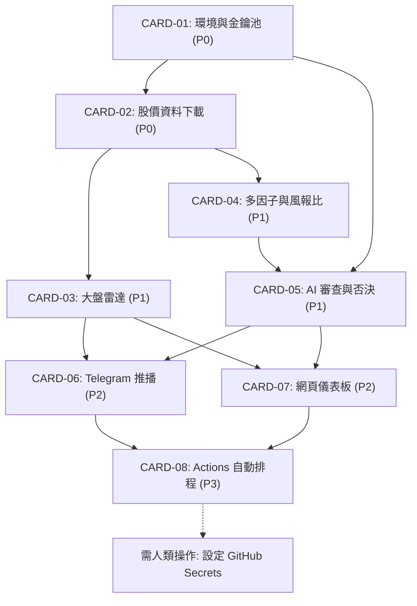

# 🗂️ 任務分流與執行看板 (Triage & Sprint Board)

本專案所有任務採用卡片索引管理法 (Card-Index)。  
任務狀態與標籤遵循 [分流標籤規範](../docs/agents/triage-labels.md) 與 [80% 簡化技術中文規範 (STE-TW)](../docs/standards/simplified-technical-chinese.md)。

---

## 1. 任務分流總表 (Triage Master Matrix)

| 執行序 | 卡片編號 | 優先級 | 任務名稱 | 權責模組 | 前置依賴 | 分流標籤 |
| :---: | :--- | :---: | :--- | :--- | :---: | :--- |
| **#1** | **[CARD-01](./CARD-01_INFRA_Gemini_Key_Pool.md)** | **P0** | 環境配置與 API 金鑰池管理 | `src/c01_config.py` | 無 | `done` |
| **#2** | **[CARD-02](./CARD-02_DATA_Market_Fetcher.md)** | **P0** | 雙市場資料下載與除權息還原 | `src/c02_data_fetcher.py` | CARD-01 | `done` |
| **#3** | **[CARD-03](./CARD-03_MACRO_Market_Radar.md)** | **P1** | 大盤雷達與防空警報模組 | `src/c03_macro_radar.py` | CARD-02 | `ready-for-agent` |
| **#4** | **[CARD-04](./CARD-04_QUANT_Multi_Factor_RRR.md)** | **P1** | 多因子評分與風報比計算引擎 | `src/c04_quant_engine.py` | CARD-02 | `ready-for-agent` |
| **#5** | **[CARD-05](./CARD-05_AI_Hindenburg_Audit.md)** | **P1** | Gemini 機構審查與風險否決 | `src/c05_ai_auditor.py` | CARD-01, CARD-04 | `ready-for-agent` |
| **#6** | **[CARD-06](./CARD-06_DELIVERY_Telegram_Card.md)** | **P2** | Telegram 晨報摘要推播模組 | `src/c06_telegram_notifier.py` | CARD-03, CARD-05 | `ready-for-agent` |
| **#7** | **[CARD-07](./CARD-07_DASHBOARD_Web_UI.md)** | **P2** | 儀表板資料產生器與展示頁面 | `docs/index.html & src/c07_dashboard_builder.py` | CARD-03, CARD-05 | `ready-for-agent` |
| **#8** | **[CARD-08](./CARD-08_WORKFLOW_GitHub_Actions.md)** | **P3** | GitHub Actions 錯峰排程與防護 | `.github/workflows/daily_quant.yml` | CARD-01 ~ CARD-07 | `ready-for-agent` |
| **H1** | **SECRETS-CONFIG** | **P0** | 配置 GitHub 儲存庫 Secrets 金鑰 | Repository Settings | CARD-08 | `ready-for-human` |

---

## 2. 模組相依拓撲圖 (Dependency DAG)

---

## 3. 開發排程說明 (Sprint Plan)

1. **第 1 階段：資料基石 (Sprint 1)**
   - 執行 CARD-01 與 CARD-02。
   - 產出物：`src/c01_config.py`、`src/c02_data_fetcher.py` 與對應單元測試。
2. **第 2 階段：核心量化與 AI 風控 (Sprint 2)**
   - 執行 CARD-03、CARD-04 與 CARD-05。
   - 產出物：大盤季線雷達、0-100 分多因子評分卡、2 倍 ATR 點位、Gemini 風控過濾網。
3. **第 3 階段：成果交付與雙通道展示 (Sprint 3)**
   - 執行 CARD-06 與 CARD-07。
   - 產出物：Telegram 晨報推播卡片、GitHub Pages 極簡深色儀表板。
4. **第 4 階段：CI/CD 雲端全自動化 (Sprint 4)**
   - 執行 CARD-08。
   - 人類協助配置 GitHub Secrets。
   - 啟用每日盤後定時錯峰執行。
