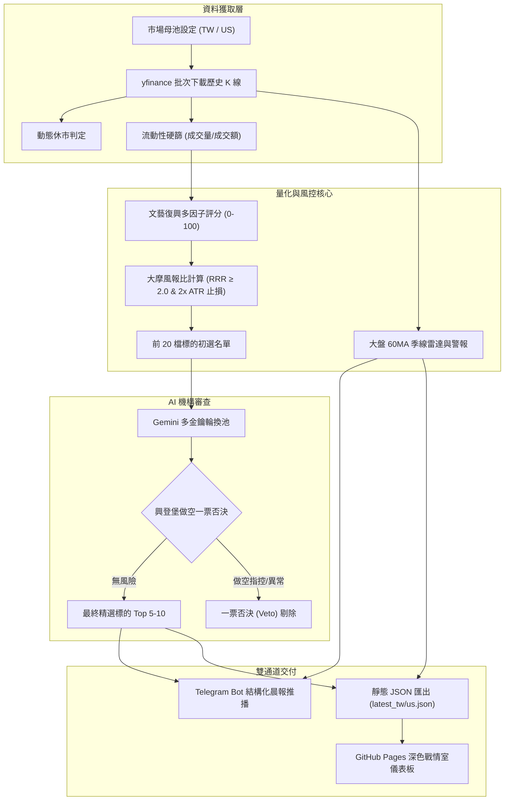

# 🏛️ 每日機構級 AI 股票量化系統 (Daily Institutional AI Quant System)

[](https://www.python.org/downloads/)
[]()
[](https://opensource.org/licenses/MIT)
[](https://github.com/judragon005/daily-ai-quant/actions)
[](https://judragon005.github.io/daily-ai-quant/)

本專案致力於每日台股與美股盤後自動化數據獲取、文藝復興多因子量化評分 (0-100)、大摩風報比計算 (RRR ≥ 2.0)、AI 機構面審查與興登堡做空一票否決，並透過純前端 GitHub Pages 儀表板與 Telegram Bot 推播晨報。

---

## 💡 核心設計哲學 (Design Philosophy)

1. **100% 無狀態設計 (Stateless)**：無須自建資料庫或常駐伺服器，所有歷史運算依賴市場還原 K 線。
2. **免費用戶全自動化 (Cost-Free)**：完全運行於 GitHub Actions 免費額度與純靜態 GitHub Pages，搭配 Gemini 免費 API 金鑰池。
3. **極致防禦與風報比優先 (Capital Preservation)**：
   - 大盤季線防空警報：跌破季線時限制多頭持倉。
   - 風報比門檻：嚴格要求潛在獲利與潛在虧損比 (RRR) ≥ 2.0。
   - 興登堡一票否決：Gemini 審查做空指控、財報造假或內線異常，違規者直接否決。

---

## 🌟 8 大功能模組與亮點

| 模組編號 | 權責模組 | 核心能力與實作特點 |
| :---: | :--- | :--- |
| **01** | **金鑰池管理** (`src/c01_config.py`) | 支援多組 Gemini API 金鑰自動輪換；遇 429 配額限制自動冷卻 60 秒切換下一組金鑰；內建環境變數解析與台美股母池。 |
| **02** | **雙市場數據下載** (`src/c02_data_fetcher.py`) | 透過 `yfinance` 批次下載 6 個月日 K 線並完成除權息還原；動態判定當日是否休市；台股 5 日均量 ≥ 1000 張 / 美股 5 日成交額 ≥ 1000 萬美元流動性硬初篩。 |
| **03** | **大盤季線雷達** (`src/c03_macro_radar.py`) | 監控加權指數 (`^TWII`) 與標普 500 (`^GSPC`) 60MA 季線生死線；計算大盤乖離率；跌破季線發送防空警報。 |
| **04** | **多因子與風報比引擎** (`src/c04_quant_engine.py`) | 文藝復興多因子評分 (0-100 分)：動能 40% + 波動穩定度 30% + 均線趨勢 30%；大摩風報比模型：止損點設為 2 倍 ATR，目標價計算動能空間，強制要求 RRR ≥ 2.0。 |
| **05** | **AI 機構審查與否決** (`src/c05_ai_auditor.py`) | 針對量化排名前 20 標的，透過 Gemini 執行機構級深度審查；嚴格執行「興登堡做空一票否決制」，過濾高風險地雷標的。 |
| **06** | **Telegram 晨報推播** (`src/c06_telegram_notifier.py`) | 生成結構化 Markdown 晨報卡片；包含大盤燈號、Top 5-10 精選標的、建議入場點、目標價、止損點與風報比；具備 Telegram 4096 字元長度保護。 |
| **07** | **現代戰情室前端** (`docs/index.html`) | 產生雙市場靜態資料 (`docs/data/latest_tw.json`, `latest_us.json`)；採用現代深色玻璃擬態 (Glassmorphism) 設計，免後端直出 GitHub Pages。 |
| **08** | **GitHub Actions 錯峰自動化** (`.github/workflows/daily_quant.yml`) | 台股盤後 15:30 (UTC 07:30) 與美股盤後 05:00 (UTC 21:00) 自動錯峰觸發；自動執行掃描、推播並提交更新 GitHub Pages。 |

---

## 🏗️ 系統架構拓撲圖 (Architecture DAG)



---

## 🚀 快速上手指南 (Runbook)

### 1. 本地環境安裝
本專案建議使用 Python 3.10 或以上版本：
```bash
# 複製儲存庫
git clone git@github.com:judragon005/daily-ai-quant.git
cd daily-ai-quant

# 安裝相依套件
pip install -r requirements.txt

# 啟用本地 Git Hooks 防呆門禁 (可選但強烈推薦)
git config core.hooksPath .githooks
```

### 2. 執行全量單元測試
專案內建 25 項完整單元測試，無須連網或外部金鑰即可秒級驗證全模組邏輯：
```bash
python -m pytest tests/
```

### 3. 模擬乾跑模式 (Dry-Run)
在無網路或離線環境下，以虛擬數據驗證完整管線：
```bash
# 模擬台股管線
python main.py --market TW --dry-run

# 模擬美股管線
python main.py --market US --dry-run
```

### 4. 本機正式執行 (需連網與金鑰)
```bash
# 設定金鑰 (亦可設定於 .env 或系統環境變數)
export GEMINI_API_KEYS="your_key_1,your_key_2"
export TELEGRAM_BOT_TOKEN="your_bot_token"
export TELEGRAM_CHAT_ID="your_chat_id"

# 執行台股分析
python main.py --market TW

# 執行美股分析
python main.py --market US
```

---

## ⚙️ 雲端全自動化配置 (GitHub Actions & Pages)

若要享受盤後無人值守之全自動分析與推播，只需在 GitHub 進行一次性設定：

### 1. 配置 GitHub Repository Secrets
前往儲存庫設定頁面：`Settings` ➔ `Secrets and variables` ➔ `Actions` ➔ `New repository secret`，新增以下 3 組金鑰：

| Secret 名稱 | 說明與來源 |
| :--- | :--- |
| **`GEMINI_API_KEYS`** | 一組或多組以逗號分隔之 Google Gemini API 金鑰（由 Google AI Studio 取得）。 |
| **`TELEGRAM_BOT_TOKEN`** | 機器人 Token（由 Telegram @BotFather 取得）。 |
| **`TELEGRAM_CHAT_ID`** | 接收推播之個人或群組 Chat ID（可由 @userinfobot 取得）。 |

### 2. 開啟 GitHub Pages 戰情室
前往：`Settings` ➔ `Pages`：
- **Build and deployment Source**：選擇 `Deploy from a branch`。
- **Branch**：選擇 `master` 分支，資料夾選擇 `/docs`。
- 儲存後即可透過 `https://<帳號>.github.io/daily-ai-quant/` 瀏覽每日儀表板。

---

## 📚 專案工程文檔索引

本專案遵循嚴格之架構治理與簡化技術中文規範：

- **[產品需求規格書 (PRD)](./docs/spec/CARD-SPEC-0001_Daily_Stock_Quant_System.md)**：包含 5 大功能需求與 6 項驗收標準。
- **[架構決策紀錄 (ADR)](./docs/adr/CARD-ADR-0001_Daily_Stock_Quant_System_Architecture.md)**：完整記錄 8 輪架構推演與選型決策。
- **[Git 工作流與門禁規範](./docs/standards/git-workflow.md)**：分支防護、本地雙門禁、結構化 PR 與合併大掃除指南。
- **[交接與維護指南 (HANDOFF.md)](./docs/HANDOFF.md)**：專案現況、維護 Runbook 與後續接手建議。
- **[80% 簡化技術中文規範 (STE-TW)](./docs/standards/simplified-technical-chinese.md)**：專案標準繁體中文技術寫作準則。
- **[術語表 (GLOSSARY.md)](./GLOSSARY.md)**：領域關鍵詞定義與計算公式。

---

## 🛡️ 授權條款 (License)

本專案採用 [MIT License](LICENSE) 授權開放。
